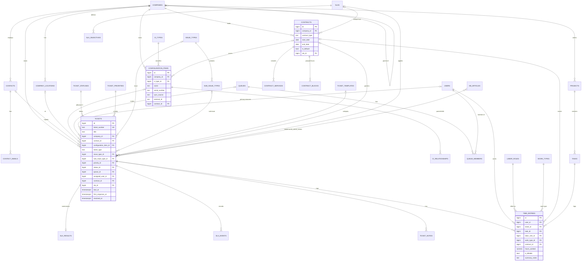

# Taskora PostgreSQL Data Model (derived from Autotask research)

> Scope: logical/physical model for Taskora phases 1–6. Autotask equivalents are given so that engineers (and a future Autotask importer) can map fields. Autotask names are from the public REST entity reference; **[C]** = confirmed there, **[U]** = assumed.
>
> This is a design document, not a migration. Column lists show the important columns; every table additionally has the conventions below.

## 0. Conventions

- **Single MSP per install** (self-hosted): no `tenant_id`. If SaaS multi-tenancy is ever needed, add `tenant_id` + RLS later.
- **PKs**: `id bigint generated always as identity`. Human-facing numbers (ticket number, CI number) are separate unique text columns.
- **Timestamps**: `timestamptz`, stored UTC (Autotask also stores/returns UTC [C]). Every table: `created_at`, `updated_at`, `created_by_user_id` (nullable for system), `updated_by_user_id`.
- **Soft delete**: `archived_at timestamptz null` on master data (companies, contacts, CIs, picklists). Picklists use `is_active` (inactive values stay on old rows but can't be newly assigned — same rule as Autotask [C]).
- **System values**: picklist tables have `code text unique null` + `is_system bool` so code references stable values (`new`, `waiting_customer`, `complete`) instead of ids.
- **Rich text**: stored as sanitized HTML in `*_html` + plain `*_text` for FTS (Autotask API loses formatting [C]; we avoid that).
- **Custom fields**: `custom_fields jsonb not null default '{}'` on entities that support UDFs (GIN index), validated against `custom_field_definitions`.
- **Search**: generated `search_vector tsvector` columns on tickets, companies, contacts, CIs, KB articles.
- **Money**: `numeric(12,2)`; hours `numeric(8,2)`; rates `numeric(10,2)`.
- Enum-like small fixed sets use Postgres `text` + `CHECK` (easier to migrate than native enums).

---

## 1. Foundation (Phase 1)

### users
Autotask: **Resources** [C].
| Column | Type | Notes / AT equivalent |
|---|---|---|
| id | bigint PK | Resources.id |
| email | citext unique not null | Resources.email |
| password_hash | text null | null when SSO-only |
| first_name, last_name | text not null | firstName, lastName |
| title | text | title |
| phone_office, phone_mobile | text | officePhone, mobilePhone |
| internal_location_id | FK → internal_locations | locationID (primary internal location) |
| timezone | text | derived from location if null |
| default_labor_role_id | FK → labor_roles null | defaultServiceDeskRoleID |
| security_role_id | FK → security_roles | userType / security level |
| is_technician | bool | resourceType [U] |
| is_active | bool | isActive |
| mfa_secret | text null (encrypted) | — |
| last_login_at | timestamptz | — |
| external_ref | text | payrollIdentifier / accountingReferenceID |

### security_roles, security_role_permissions
RBAC. `security_roles(id, name, code, is_system)`; `security_role_permissions(role_id, permission text)`; permission strings like `tickets.edit`, `time.approve`, `contracts.view`. Autotask: security levels [C, details U].

### sessions / api_tokens
Standard auth tables (`user_id`, `token_hash`, `expires_at`, `last_used_at`).

### internal_locations
Autotask: internal locations (referenced by Resources.locationID, queues, SLA business hours) [C concept].
`id, name, timezone text not null, address fields, holiday_set_id FK, is_default bool`.

### business_hours
`id, internal_location_id FK (null for custom set), name, kind ('business'|'extended')`;
`business_hours_intervals(business_hours_id, weekday smallint 0-6, start_time time, end_time time)`.
Autotask SLA timeframes: Business Hours / Extended Hours / All 24x7 [C].

### holiday_sets, holidays
`holiday_sets(id, name)`; `holidays(id, holiday_set_id FK, date, name)`.

### companies
Autotask: **Companies** [C].
| Column | Type | AT equivalent |
|---|---|---|
| id | bigint PK | id |
| name | text not null | companyName |
| number | text unique null | companyNumber |
| short_code | text unique null | — (Taskora; used in ticket lists) |
| company_type | text check in ('customer','lead','prospect','dead','cancelation','vendor','partner') | companyType |
| parent_company_id | FK → companies null | parentCompanyID (enforce 2 levels via trigger) |
| account_manager_user_id | FK → users null | ownerResourceID |
| phone, fax, website | text | phone, fax, webAddress |
| primary_location_id | FK → company_locations null | (isPrimary on location) |
| classification, territory, market_segment | text null | classification, territoryID, marketSegmentID (as tags/simple text) |
| is_active | bool | isActive |
| alert_text | text null | CompanyAlerts (simplified) |
| tax_exempt, tax_region | bool, text | isTaxExempt, taxRegionID (phase 5) |
| currency_code | char(3) | currencyID |
| custom_fields | jsonb | UDFs (≤200 in AT) |
| last_activity_at | timestamptz | lastActivityDate |
| search_vector | tsvector | — |

Card.: company 1—N contacts, locations, tickets, CIs, contracts, projects; company 0..1—N sub-companies.

### company_locations
Autotask: **CompanyLocations** [C].
`id, company_id FK not null, name not null, address1, address2, city, state, postal_code, country_code, phone, fax, description, is_primary bool, is_active bool, timezone text null (Taskora addition), roundtrip_distance numeric null`.
Constraint: partial unique index `(company_id) where is_primary`.

### contacts
Autotask: **Contacts** [C].
| Column | Type | AT equivalent |
|---|---|---|
| id | bigint PK | id |
| company_id | FK → companies not null | companyID |
| company_location_id | FK → company_locations null | companyLocationID |
| first_name, last_name | text not null | firstName, lastName |
| title | text | title |
| phone, phone_ext, mobile_phone, alternate_phone | text | phone, extension, mobilePhone, alternatePhone |
| is_primary | bool | primaryContact (partial unique per company) |
| is_billing_contact | bool | billingContact |
| receives_notifications | bool default true | receivesEmailNotifications |
| is_vip | bool | — (Taskora) |
| is_active | bool | isActive |
| external_id | text | externalID |
| notes | text | note |
| custom_fields | jsonb | UDFs |

### contact_emails
Replaces AT `emailAddress`, `emailAddress2`, `emailAddress3` [C] (the latter two are used by incoming email processing).
`id, contact_id FK, email citext, is_primary bool`; unique `(email)` among active contacts (enables sender→contact matching).

### company_notes, attachments
`company_notes(id, company_id, title, body_html, note_type, created_by_user_id)` — AT CompanyNotes [C].
`attachments(id, owner_type text, owner_id bigint, file_name, content_type, size_bytes, storage_key, sha256, is_customer_visible)` — polymorphic, used for companies, tickets, notes, CIs, KB.

### audit_events
`id, entity_type, entity_id, action ('create'|'update'|'delete'|'status_change'...), actor_user_id, actor_contact_id, occurred_at, changes jsonb ({field: [old,new]})`. Source for ticket/CI history pages. AT: ticket history, CI version history, lastTrackedModificationDateTime [C].

### settings
`settings(key text PK, value jsonb)` for system switches (e.g. `tickets.require_issue_type`, `time.require_summary_notes`, `email.loop_limit`) — AT system settings [C concept].

---

## 2. Service desk (Phase 2)

### Picklist tables

| Table | Columns | AT equivalent |
|---|---|---|
| ticket_statuses | id, name, code, is_system, sla_event text check in (null,'first_response','resolution_plan','waiting_customer','resolved'), color, icon, sort_order, is_active, is_closed bool | Ticket `status` picklist + Task & Ticket Statuses admin [C]. Seed: New (code `new`, sla null), In Progress (`first_response`), Waiting Customer (`waiting_customer`, system), Waiting Vendor (`first_response` or none — decide), Complete (`complete`, `resolved`, system, is_closed) |
| ticket_priorities | id, name, code, sort_order, color, is_active, is_default | `priority` picklist [C] |
| ticket_sources | id, name, code (`phone`,`email`,`portal`,`monitoring`,`manual`,`workflow`,`api`), is_active | `source` picklist [C field; values U] |
| queues | id, name unique, number, description, internal_location_id FK not null, is_system, code, is_active, other_emails text[] | Queues admin [C] |
| queue_members | queue_id FK, user_id FK, is_owner bool; PK(queue_id,user_id) | Queue resources + owner [C] |
| issue_types | id, name, queue_id FK null, is_active | Issue types + associated queue [C] |
| sub_issue_types | id, issue_type_id FK not null, name, queue_id FK null, excluded_from_new_contracts bool, is_active; unique(issue_type_id,name) | Sub-issue types [C] |
| ticket_templates | id, name (≤30 in AT), nickname, color, is_default, is_active, defaults jsonb (title, description, ticket_type, priority_id, status_id, queue_id, issue_type_id, sub_issue_type_id, source_id, sla_id, work_type_id, estimated_hours, due_offset), required_fields text[], require_note_titles bool | TicketCategories + TicketCategoryFieldDefaults [C] |
| tags, ticket_tags | tags(id, name unique); ticket_tags(ticket_id, tag_id) | Tag associations [C] |

`ticket_type` is a fixed text check (`service_request`,`incident`,`problem`,`change_request`,`alert`) [C].

### tickets
Autotask: **Tickets** [C]. Columns in phase order; phase-5 columns are created nullable in phase 2 to avoid later table rewrites.

| Column | Type | Null | AT field |
|---|---|---|---|
| id | bigint PK | | id |
| ticket_number | text unique not null | | ticketNumber (`T20261020.0001`) |
| title | text (≤255) | not null | title |
| description_html / description_text | text | | description |
| company_id | FK companies | not null | companyID |
| company_location_id | FK company_locations | null | companyLocationID |
| contact_id | FK contacts | null | contactID |
| configuration_item_id | FK configuration_items | null | configurationItemID (phase 3 FK) |
| ticket_type | text check | not null default 'service_request' | ticketType |
| template_id | FK ticket_templates | null | ticketCategory |
| issue_type_id | FK issue_types | null | issueType |
| sub_issue_type_id | FK sub_issue_types | null | subIssueType (CHECK via trigger: belongs to issue_type) |
| priority_id | FK ticket_priorities | not null | priority |
| status_id | FK ticket_statuses | not null | status |
| source_id | FK ticket_sources | null | source |
| queue_id | FK queues | null | queueID |
| assigned_user_id | FK users | null | assignedResourceID |
| assigned_labor_role_id | FK labor_roles | null | assignedResourceRoleID |
| due_at | timestamptz | null | dueDateTime |
| estimated_hours | numeric(8,2) | null | estimatedHours |
| resolution_html / resolution_text | text | null | resolution |
| problem_ticket_id | FK tickets | null | problemTicketId (only when type=incident) |
| project_id | FK projects | null | projectID (phase 5) |
| external_id | text | null | externalID |
| purchase_order_number | text | null | purchaseOrderNumber |
| work_type_id | FK work_types | null | billingCodeID (default work type for time) |
| contract_id | FK contracts | null | contractID (phase 5) |
| contract_service_id | FK contract_services | null | contractServiceID (phase 5) |
| sla_id | FK slas | null | serviceLevelAgreementID (phase 5) |
| first_response_due_at | timestamptz | null | firstResponseDueDateTime |
| first_response_at | timestamptz | null | firstResponseDateTime |
| first_response_user_id | FK users | null | firstResponseInitiatingResourceID |
| resolution_plan_due_at | timestamptz | null | resolutionPlanDueDateTime |
| resolution_plan_at | timestamptz | null | resolutionPlanDateTime |
| resolved_due_at | timestamptz | null | resolvedDueDateTime |
| resolved_at | timestamptz | null | resolvedDateTime |
| sla_paused_since | timestamptz | null | (pause state; AT exposes serviceLevelAgreementPausedNextEventHours) |
| sla_paused_seconds | integer default 0 | | — |
| sla_met | bool | null | serviceLevelAgreementHasBeenMet |
| completed_at | timestamptz | null | completedDate |
| completed_by_user_id | FK users | null | completedByResourceID |
| created_by_user_id / created_by_contact_id | FK | null | creatorResourceID / createdByContactID |
| last_activity_at | timestamptz | | lastActivityDate |
| last_activity_user_id | FK users | null | lastActivityResourceID |
| last_customer_notified_at | timestamptz | null | lastCustomerNotificationDateTime |
| last_customer_visible_activity_at | timestamptz | null | lastCustomerVisibleActivityDateTime |
| rmm_alert_ref | text | null | rMMAlertID (Action1 alert id later) |
| custom_fields | jsonb | | UDFs (≤300 in AT) |
| search_vector | tsvector | | — |

Indexes: `(status_id, queue_id)`, `(assigned_user_id) where completed_at is null`, `(company_id, created_at desc)`, `(resolved_due_at) where resolved_at is null`, GIN on `search_vector`, `custom_fields`.

Business constraints (from AT [C]): contact/CI/project must belong to `company_id` or its parent; location must belong to company; company cannot change once billed time exists; sub-issue requires issue; only incidents may have `problem_ticket_id`.

### ticket_number_sequences
`(day date PK, last_value int)` — `UPDATE … RETURNING` inside the insert transaction to produce `T{YYYYMMDD}.{NNNN}` [C format].

### ticket_secondary_resources
AT **TicketSecondaryResources** [C]: `ticket_id, user_id, labor_role_id`; PK(ticket_id,user_id); primary may not be secondary [C].

### ticket_notes
AT **TicketNotes** [C].
| Column | Type | AT |
|---|---|---|
| id | bigint PK | id |
| ticket_id | FK not null | ticketID |
| title | text null | title (≤250; required if template says) |
| body_html / body_text | text not null | description (≤32000) |
| note_type | text check ('manual','email_in','email_out','workflow','system','resolution') | noteType (13 = system workflow note [C]) |
| visibility | text check ('internal','customer') | publish |
| append_to_resolution | bool | (AT "append" checkboxes [C via KB-from-ticket]) |
| author_user_id / author_contact_id | FK | creatorResourceID / createdByContactID |
| email_message_id | text null | — (threading for email intake) |
| status_changed_to_id | FK ticket_statuses null | (status change captured with note → SLA timing source [C]) |

### ticket_checklist_items
AT **TicketChecklistItems** [C]: `id, ticket_id, position int, name (≤600), is_important bool, is_completed bool, completed_at, completed_by_user_id, kb_article_id FK null`.

### ticket_status_history
`id, ticket_id, from_status_id, to_status_id, changed_at, changed_by_user_id, source ('ui','email','workflow','api','time_entry','note')`. Drives SLA events & reports.

### labor_roles
AT **Roles** [C]: `id, name, description, hourly_rate numeric, hourly_factor numeric default 1, is_active, excluded_from_new_contracts bool`.
`user_labor_roles(user_id, labor_role_id)` — resource-role associations [C].

### work_types
AT **BillingCodes** with useType=1 [C]: `id, name, description, external_number, rate_multiplier numeric default 1 [U name], is_billable_default bool, after_hours_work_type_id FK work_types null (afterHoursWorkType [C]), excluded_from_new_contracts bool, is_active`.

### internal_time_categories
AT BillingCodes useType=3 / `internalBillingCodeID` [C]: `id, name, code ('meeting','admin','training','holiday','sick','vacation'...), is_active`.

### time_entries
AT **TimeEntries** [C].
| Column | Type | AT |
|---|---|---|
| id | bigint PK | id |
| user_id | FK users not null | resourceID |
| entry_kind | text check ('ticket','task','general') | timeEntryType (2 ticket, 6 task [C]) |
| ticket_id | FK tickets null | ticketID |
| task_id | FK tasks null | taskID (phase 5) |
| internal_time_category_id | FK null | internalBillingCodeID (general only) |
| labor_role_id | FK labor_roles not null for ticket/task | roleID |
| work_type_id | FK work_types null | billingCodeID |
| date_worked | date not null | dateWorked |
| start_at, end_at | timestamptz null | startDateTime, endDateTime (end > start) |
| hours_worked | numeric(6,2) not null check (>0 and ≤24) | hoursWorked |
| offset_hours | numeric(6,2) default 0 | offsetHours |
| hours_to_bill | numeric(6,2) | hoursToBill (computed on approval) |
| summary_notes | text not null for ticket/task | summaryNotes (customer-facing) |
| internal_notes | text | internalNotes |
| is_billable | bool | NOT isNonBillable |
| show_on_invoice | bool | showOnInvoice |
| append_to_resolution | bool | (AT append checkbox) |
| contract_id | FK contracts null | contractID (inherited from ticket on create) |
| contract_service_id | FK null | contractServiceID |
| timesheet_id | FK timesheets null | (timesheet membership; phase 5) |
| approval_status | text check ('pending','approved','rejected','posted') | billingApproval* fields |
| approved_at, approved_by_user_id | | billingApprovalDateTime, billingApprovalResourceID |
| posted_at, billing_item_id | | Approve & Post [C] |
CHECK: exactly one of (ticket_id, task_id, internal_time_category_id) set according to `entry_kind`; general ⇒ not billable [C].

### ticket_timers
`id, ticket_id, user_id, started_at, paused_seconds, stopped_at` — Taskora UX; converts to a time entry.

### email_mailboxes, inbound_emails
`email_mailboxes(id, name, protocol ('imap','graph'), host, username, secret_ref, default_queue_id, default_template_id, default_priority_id, is_active)`;
`inbound_emails(id, mailbox_id, message_id unique, from_address, subject, received_at, processed_at, result ('ticket_created','note_added','rejected_loop','error'), ticket_id, error)`. AT Incoming Email Processing [C]: new subject → ticket (subject→title, body→description); subject containing ticket number → note; ≤2 same sender+subject per 5 min.

### notification_outbox, notification_templates
`notification_templates(id, event_code, name, subject_tpl, body_tpl, is_active)`;
`notification_outbox(id, template_id, to_address, to_user_id, to_contact_id, subject, body_html, related_type, related_id, status ('queued','sent','failed'), attempts, sent_at, error)`.

---

## 3. CMDB (Phase 3)

### ci_types
AT **ConfigurationItemCategories** (+ legacy ConfigurationItemTypes) [C]: `id, name unique, nickname, color, icon, is_active, field_schema jsonb (which custom fields apply)` — mirrors ConfigurationItemCategoryUdfAssociations [C].

### configuration_items
AT **ConfigurationItems** [C].
| Column | Type | AT |
|---|---|---|
| id | bigint PK | id |
| ci_number | text unique | — |
| company_id | FK not null | companyID (immutable in AT) |
| company_location_id | FK null | companyLocationID |
| contact_id | FK null | contactID (primary user) |
| ci_type_id | FK ci_types not null | configurationItemCategoryID |
| product_id | FK products null | productID (required in AT; optional here) |
| name | text not null | referenceTitle |
| reference_number | text | referenceNumber |
| serial_number | text | serialNumber |
| location_detail | text | location |
| notes | text | notes |
| status | text check ('planned','in_stock','active','in_repair','retired','disposed') | isActive (bool) — richer lifecycle in Taskora |
| install_date | date | installDate |
| installed_by_user_id | FK users | installedByID |
| warranty_expires_on | date | warrantyExpirationDate |
| vendor_company_id | FK companies | vendorID |
| contract_id | FK contracts null | contractID (phase 5) |
| contract_service_id | FK contract_services null | contractServiceID |
| sla_id | FK slas null | serviceLevelAgreementID |
| hostname | text | rmmDeviceAuditHostname |
| os_name, os_version | text | rmmDeviceAuditOperatingSystem |
| manufacturer, model | text | rmmDeviceAuditManufacturerID / ModelID |
| cpu | text | rmmDeviceAuditProcessorID |
| ram_bytes, storage_bytes | bigint | rmmDeviceAuditMemoryBytes / StorageBytes |
| ip_addresses | inet[] | rmmDeviceAuditIPAddress |
| external_ip | inet | rmmDeviceAuditExternalIPAddress |
| mac_addresses | macaddr[] | rmmDeviceAuditMacAddress |
| last_user | text | rmmDeviceAuditLastUser |
| patch_status | text | rmmDeviceAuditPatchStatusID |
| missing_patch_count | int | rmmDeviceAuditMissingPatchCount |
| sync_source | text ('manual','action1','import') | apiVendorID |
| external_id | text | rmmDeviceUID / rmmDeviceID |
| last_seen_at | timestamptz | (RMM last check-in) |
| raw_data | jsonb | — |
| custom_fields | jsonb | UDFs (≤500 in AT; protected/encrypted supported) |
| search_vector | tsvector | — |
Unique `(sync_source, external_id) where external_id is not null`.

### ci_relationships
Replaces AT `parentConfigurationItemID` (2-level) [C]: `id, parent_ci_id FK, child_ci_id FK, relationship_type ('contains','runs_on','connected_to','depends_on','licensed_to'), created_at`; unique(parent, child, type); no self-reference.

### ci_notes
`id, ci_id, body_html, author_user_id` (AT CI notes [U entity name]).

### products (phase 5, optional)
AT **Products** [C]: `id, name, description, sku, manufacturer_name, manufacturer_product_name, default_ci_type_id (defaultInstalledProductCategoryID), default_vendor_company_id, vendor_product_number, unit_cost, unit_price, msrp, is_serialized, period_type, is_active`.

---

## 4. Action1 integration (Phase 4)

| Table | Columns |
|---|---|
| integrations | id, kind ('action1'), name, base_url/region, client_id, secret_ref (encrypted), settings jsonb (sync interval, default ci_type mapping), is_active |
| integration_company_maps | integration_id, external_org_id, external_org_name, company_id FK; unique(integration_id, external_org_id) |
| integration_runs | id, integration_id, started_at, finished_at, status, items_seen, items_created, items_updated, items_stale, error |
| integration_items | integration_id, external_id, entity_type ('ci'), entity_id, last_payload_hash, last_synced_at |

See also `action1-api.md` in this folder (separate Action1 research) for endpoint field names; reconcile CI sync columns against it. From this research alone, Action1 field names are **[U]** (public docs confirm `/organizations` endpoint, JWT bearer auth, paginated ResultPage, ~30 req/min recommendation; endpoint field schema not public).

---

## 5. Contracts, SLA, billing, projects, KB (Phase 5)

### contracts
AT **Contracts** [C].
| Column | Type | AT |
|---|---|---|
| id | bigint PK | id |
| company_id | FK not null | companyID (Customer type only) |
| name | text not null | contractName |
| number | text | contractNumber |
| contract_type | text check ('time_materials','fixed_price','block_hours','retainer','per_ticket','recurring_service') | contractType (Recurring = 7 [C]; Per Ticket = "Incident" in API) |
| category | text | contractCategory |
| status | text check ('active','inactive') | status |
| start_date, end_date | date not null | startDate, endDate |
| is_default | bool | isDefaultContract (one overlapping default per company) |
| sla_id | FK slas | serviceLevelAgreementID |
| contact_id | FK contacts | contactID |
| bill_to_company_id, bill_to_contact_id | FK | billToCompanyID, billToCompanyContactID |
| period_type | text ('monthly','quarterly','semi_annual','yearly') | contractPeriodType (recurring) |
| setup_fee | numeric | setupFee |
| overage_rate | numeric | overageBillingRate |
| estimated_hours/cost/revenue | numeric | estimated* |
| exclusion_set_id | FK contract_exclusion_sets | contractExclusionSetID |
| exclusion_contract_id | FK contracts | exclusionContractID |
| labor_approval_mode | text ('manual','on_timesheet_approval','immediate') | billingPreference (2 = manual/reconcile [C]) |
| requires_start_stop | bool | timeReportingRequiresStartAndStopTimes |
| renewed_from_contract_id | FK contracts | renewedContractID |
| purchase_order_number | text | purchaseOrderNumber |
| custom_fields | jsonb | UDFs (≤50) |

Type-specific children:
| Table | Columns | AT entity |
|---|---|---|
| contract_rates | contract_id, labor_role_id, hourly_rate | contract role rates (T&M) [C concept] |
| contract_block_hour_factors | contract_id, labor_role_id, factor | ContractBlockHourFactors [C] |
| contract_blocks | id, contract_id, date_purchased, start_date, end_date, hours, hours_used (derived), hourly_rate, is_paid, invoice_number, status | ContractBlocks [C] |
| contract_retainers | id, contract_id, date_purchased, start_date, end_date, amount, amount_used, is_paid, status | ContractRetainers [C] |
| contract_ticket_purchases | id, contract_id, date_purchased, start_date, end_date, tickets_purchased, tickets_used, per_ticket_rate, is_paid | ContractTicketPurchases [C] |
| contract_milestones | id, contract_id, title, amount, due_date, status ('pending','ready_to_bill','billed') | Fixed price milestones [C concept, entity name U] |
| services | id, name, description, period_type, unit_price, unit_cost, vendor_company_id, sla_id, is_active | Services [C] |
| contract_services | id, contract_id, service_id, quantity (units), unit_price, unit_cost, invoice_description, start_date | ContractServices (+ units) [C] |
| contract_exclusion_sets | id, name unique, description, is_active | ContractExclusionSets [C] |
| contract_exclusions | id, contract_id null, exclusion_set_id null, labor_role_id null, work_type_id null, sub_issue_type_id null (exactly one target) | ContractExclusionSetExcludedRoles/WorkTypes, sub-issue exclusions [C] |

### slas
AT SLA admin [C] (no REST "ServiceLevelAgreements" entity page; SLA is a picklist on tickets) .
`id, name, description, business_hours_id FK (null = 24x7 default), holiday_set_id, set_ticket_due_date bool, first_response_goal_pct, resolution_plan_goal_pct, resolved_goal_pct, is_active`.

### sla_objectives
`id, sla_id FK, priority_id null, ticket_type null, template_id null, issue_type_id null, sub_issue_type_id null` (null = [All]); `first_response_mode/value`, `resolution_plan_mode/value`, `resolved_mode/value` where mode ∈ ('within_hours','end_of_day_min_hours','end_of_next_day_min_hours') [C]; `timeframe` ∈ ('business','extended','24x7') [C]; `is_default bool`, `is_active`.
Unique index on `(sla_id, coalesce(priority_id,0), coalesce(ticket_type,''), coalesce(template_id,0), coalesce(issue_type_id,0), coalesce(sub_issue_type_id,0))`.

### sla_events
Append-only. `id, ticket_id, event ('start','first_response','resolution_plan','pause','resume','resolved','reopen'), occurred_at, user_id, source ('status_change','note','time_entry','workflow','backfill','manual_edit'), status_id`.

### sla_results
AT **ServiceLevelAgreementResults** [C]: `ticket_id PK, sla_name, first_response_elapsed_hours, is_first_response_met, first_response_user_id, first_response_initiating_user_id, resolution_plan_elapsed_hours, is_resolution_plan_met, resolution_plan_user_id, resolution_elapsed_hours, is_resolution_met, resolution_user_id, computed_at`.

### timesheets
`id, user_id, week_start date, status ('new','submitted','approved','rejected'), submitted_at, approved_at, approved_by_user_id, rejection_reason`; unique(user_id, week_start). Entries only added in new/rejected [C].

### billing_items
Result of Approve & Post [C]: `id, item_type ('labor','charge','expense','recurring_service','milestone','block_purchase','retainer_purchase','ticket_purchase'), company_id, contract_id, source_type, source_id, description, quantity, unit_price, extended_price, posted_at, posted_by_user_id, invoice_ref`.

### ticket_charges (P2)
AT **TicketCharges** [C]: `id, ticket_id, product_id null, name, description, quantity, unit_cost, unit_price, is_billable, date_purchased, status, billing_item_id`.

### projects, project_phases, tasks
AT **Projects / Phases / Tasks** [C].
- `projects(id, number unique, name, company_id, project_type ('client','internal','template'), status_id → project_statuses, lead_user_id, contract_id, start_date, end_date, description, estimated_hours, completed_at, custom_fields)`.
- `project_phases(id, project_id, parent_phase_id null, title, description, start_date, due_date, sort_order)`.
- `tasks(id, project_id not null, phase_id null, task_number, title, description_html, status_id → ticket_statuses (shared list [C]), priority_label, sort_order, assigned_user_id, assigned_labor_role_id, work_type_id (required if assigned [C]), estimated_hours, remaining_hours, start_date, end_date, is_visible_in_portal, completed_at, completed_by_user_id)`.
- `task_dependencies(predecessor_task_id, successor_task_id, lag_days)`.
- `task_secondary_resources(task_id, user_id, labor_role_id)`.

### appointments (dispatch)
Simplified AT ServiceCalls + ServiceCallTickets/Tasks + resources [C]: `appointments(id, company_id, company_location_id, ticket_id null, task_id null, title, description, start_at, end_at, status ('scheduled','completed','canceled'), canceled_at, canceled_by_user_id)`; `appointment_resources(appointment_id, user_id)`.

### knowledge base
AT **KnowledgeBaseArticles** [C].
- `kb_categories(id, parent_id null, name, sort_order)`.
- `kb_articles(id, category_id, title (≤200), body_html, body_text, keywords text, error_codes text, reference_link, visibility ('internal','all_customers','company'), visibility_company_id null, status ('draft','published','archived'), current_version int, is_active, created_by_user_id, updated_by_user_id, search_vector)`.
- `kb_article_versions(article_id, version, title, body_html, created_by_user_id, created_at)`.
- `kb_article_tickets(article_id, ticket_id, linked_by_user_id)` — ArticleTicketAssociations [C].
- `kb_article_tags(article_id, tag_id)`.

---

## 6. Automation, custom fields, reporting (Phase 6)

| Table | Columns | AT |
|---|---|---|
| custom_field_definitions | id, entity_type ('company','contact','ticket','ci','contract','project','task'), key (slug), label, data_type ('text','textarea','number','date','list','multi_list','email','url','bool'), list_options jsonb, default_value, decimals, is_required, is_protected, is_customer_visible, sort_order, is_active | UserDefinedFieldDefinitions + ListItems [C] |
| workflow_rules | id, name, description, entity_type, is_active, events jsonb, conditions jsonb, time_window jsonb, updates jsonb, actions jsonb, notifications jsonb, documentation_url, sort_order | Workflow rules [C] |
| workflow_rule_runs | id, rule_id, entity_type, entity_id, trigger_event, fired_at, depth smallint (≤5), result ('applied','skipped','error'), changes jsonb, error | Audit workflow rules [C link] |
| scheduled_triggers | id, rule_id, entity_id, fire_at, recurrence_index, status | time-based events / recurrence (≤10) [C] |
| saved_views | id, user_id null (shared), entity_type, name, filters jsonb, columns jsonb, sort jsonb | search pages / LiveReports-lite |
| dashboards, dashboard_widgets | dashboards(id, user_id, name); widgets(id, dashboard_id, type, entity_type, config jsonb, position) | Dashboard widgets (≤24/tab) [C] |

Reporting views: `v_ticket_facts`, `v_time_facts`, `v_sla_facts`, `v_contract_balance`.

---

## 7. Cardinality summary

| Relationship | Cardinality |
|---|---|
| company → sub-companies | 1 : 0..N (max depth 2) |
| company → locations / contacts / tickets / CIs / contracts / projects | 1 : 0..N |
| contact → tickets | 1 : 0..N (ticket has 0..1 contact) |
| ticket → CI | N : 0..1 (Taskora may later add `ticket_cis` M:N for multi-asset tickets) |
| ticket → notes / time entries / checklist items / attachments / status history | 1 : 0..N |
| ticket → secondary resources | M : N via ticket_secondary_resources |
| ticket → queue | N : 0..1 |
| ticket → contract | N : 0..1 ; contract → ticket 1 : 0..N |
| ticket → SLA | N : 0..1 ; ticket → sla_results 1 : 0..1 ; ticket → sla_events 1 : 0..N |
| issue_type → sub_issue_types | 1 : 0..N |
| time entry → ticket XOR task XOR internal category | exactly one |
| time entry → contract | N : 0..1 |
| CI → contract / contract_service / SLA | N : 0..1 |
| CI ↔ CI | M : N typed (ci_relationships) |
| contract → blocks / retainers / ticket purchases / services / milestones | 1 : 0..N (type-dependent) |
| SLA → objectives | 1 : 1..N (exactly one default) |
| queue ↔ users | M : N (queue_members) |
| user ↔ labor roles | M : N |
| project → phases → tasks | 1 : N : N |
| KB article ↔ tickets | M : N |

---

## 8. Core ER diagram

---

## 9. Derivation rules encoded in services (not schema)

1. **Ticket contract resolution** (on create and when CI/company/sub-issue changes) [C]: CI.contract (active, date-valid) → company default contract → parent company default → if sub-issue excluded: contract.exclusion_contract or null.
2. **Ticket SLA resolution** [C]: CI.sla → contract_service.sla → contract.sla → template.sla → (Taskora) global default SLA.
3. **SLA objective match** [C]: filter active objectives of SLA where each dimension equals ticket value or is null; pick most specific, tie-break by dimension order Priority > Type > Category > Issue > Sub-issue.
4. **Time entry contract** [C]: inherit ticket.contract on create; if labor role or work type is excluded → exclusion contract or null.
5. **Labour price** [C/U]: (contract_rates.rate ?? labor_roles.hourly_rate) × work_types.rate_multiplier; block-hours deduction = hours × block hour factor.
6. **Ticket number**: `T` + local date (MSP default TZ) `YYYYMMDD` + `.` + 4-digit daily counter.

## Confirmed vs uncertain

- **Confirmed**: All "AT" field names quoted from REST entity pages (Tickets, TicketNotes, TimeEntries, ConfigurationItems, Contracts, ContractServices/Blocks/Retainers/TicketPurchases, ExclusionSets, SLA Results, Companies, Contacts, CompanyLocations, Resources, Roles, BillingCodes, Services, Projects, Phases, Tasks, Products, InventoryItems, KB Articles, TicketCategories/FieldDefaults, ChecklistItems, SecondaryResources, Charges, ServiceCalls, UDF definitions). SLA objective dimensions & target modes; status→SLA event mapping defaults; contract precedence.
- **Uncertain / Taskora decisions**: work-type multiplier column name in AT; numeric picklist values; ticket source values; CI note entity name; milestone entity name; project type values; Action1 endpoint field names; whether AT allows multiple CIs per ticket (AT ticket has a single `configurationItemID` — confirmed — but UI "additional devices" may exist [U]).

## Sources

- REST entity pages under https://www.autotask.net/help/developerhelp/Content/APIs/REST/Entities/ : TicketsEntity, TicketNotesEntity, TimeEntriesEntity, ConfigurationItemsEntity, ConfigurationItemTypesEntity, ConfigurationItemCategoriesEntity, ContractsEntity, ContractServicesEntity, ContractBlocksEntity, ContractRetainersEntity, ContractTicketPurchasesEntity, ContractExclusionSetsEntity, ServiceLevelAgreementResultsEntity, CompaniesEntity, ContactsEntity, CompanyLocationsEntity, ResourcesEntity, RolesEntity, BillingCodesEntity, ServicesEntity, ProjectsEntity, PhasesEntity, TasksEntity, ProductsEntity, InventoryItemsEntity, KnowledgeBaseArticlesEntity, TicketCategoriesEntity, TicketCategoryFieldDefaultsEntity, TicketChecklistItemsEntity, TicketSecondaryResourcesEntity, TicketChargesEntity, ServiceCallsEntity, OpportunitiesEntity; https://autotask.net/help/DeveloperHelp/Content/APIs/REST/Entities/UserDefinedFieldDefinitionsEntity.htm
- https://autotask.net/help/Content/3_Features/7_ServiceDeskAutomation/ServiceLevelManagement/SLAMAIN.htm
- https://autotask.net/help/Content/4_Admin/2FeaturesSettings/ServiceDeskTickets/SLAAdmin/SLAAddEdit.htm
- https://autotask.net/help/Content/4_Admin/2FeaturesSettings/ServiceDeskTickets/SLAAdmin/SLAstatusmapping.htm
- https://autotask.net/help/Content/4_Admin/2FeaturesSettings/ServiceDeskTickets/Tickets/Task_Ticket_Statuses.htm
- https://autotask.net/help/Content/4_Admin/2FeaturesSettings/ServiceDeskTickets/Tickets/IssueandSubIssueTypes.htm
- https://autotask.net/help/Content/4_Admin/2FeaturesSettings/ServiceDeskTickets/Tickets/QueuesManage.htm
- https://autotask.net/help/Content/3_Features/6_Contracts/AdminGeneral/BusinessCaseContracts.htm
- https://autotask.net/help/Content/3_Features/6_Contracts/AdminGeneral/ApplyContractToTicketProject.htm
- https://autotask.net/help/Content/3_Features/10_Billing/ApprovePost/Approve_Post.htm
- https://autotask.net/help/Content/3_Features/3_CRM/Companies/COMPANIESMAIN.htm
- https://autotask.net/help/Content/4_Admin/3Automation/WorkflowRules/WorkflowRulesCreatingEditing.htm
- https://www.action1.com/api-documentation/making-example-calls/ (via search summary)
